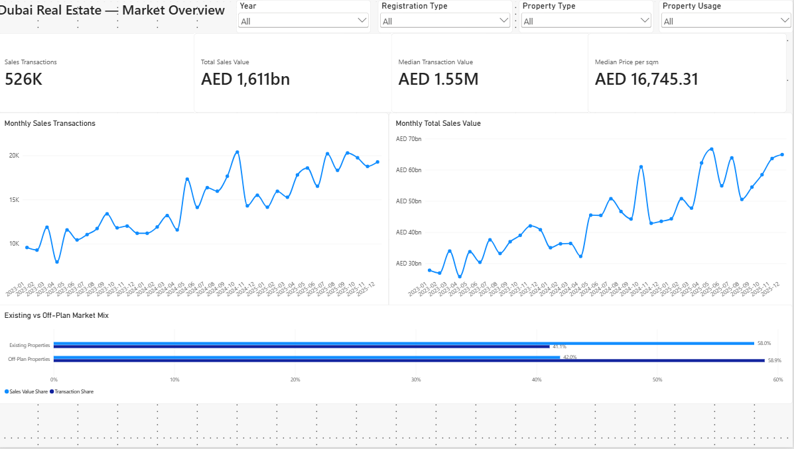
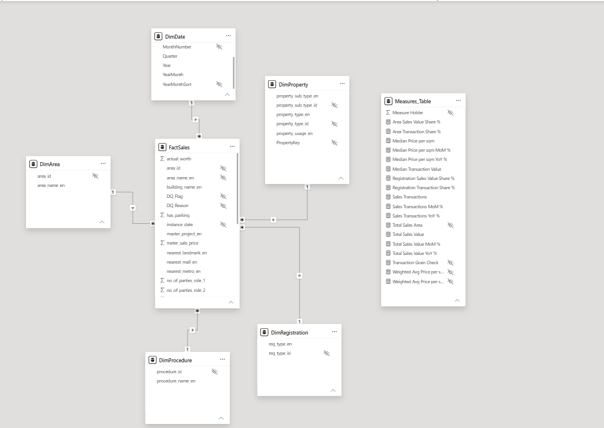
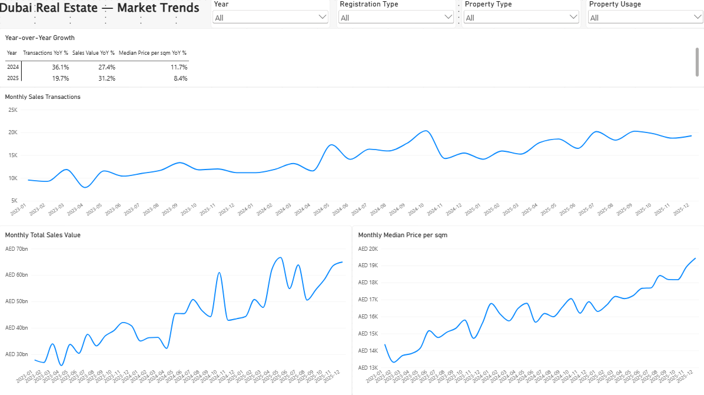
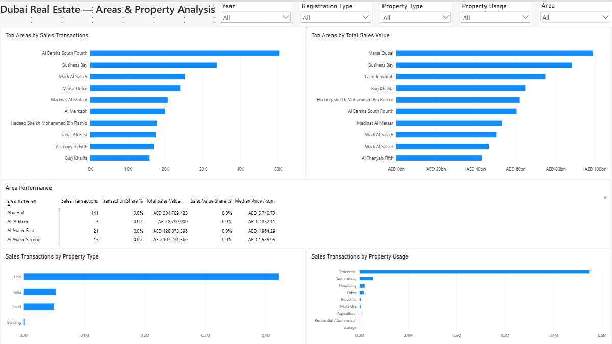
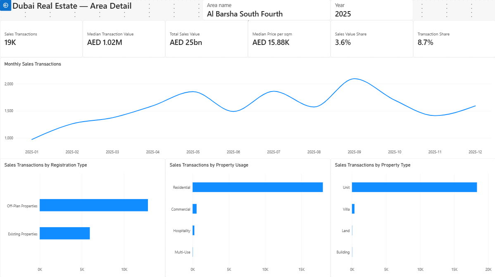

# Dubai Real Estate Sales Performance & Trends (2023–2025)

An interactive Power BI portfolio project analysing how Dubai real estate sales activity, transaction value, price per square metre, and market mix changed between 2023 and 2025.

The report is designed for market-intelligence and business-analysis use while demonstrating an end-to-end Power BI workflow: data profiling, Power Query transformations, dimensional modelling, explicit DAX measures, validation, interactive reporting, and performance review.

## Project scope

- **Market:** Dubai real estate
- **Period:** 2023–2025
- **Transaction scope:** Sales only; mortgage and gift records are excluded
- **Currency:** AED
- **Fact-table grain:** One recorded sales transaction per `transaction_id`
- **Dataset size:** 526,056 sales transactions

The analysis focuses on four questions:

1. How did sales activity and value change over time?
2. Did transaction volume, total value, and the median price per square metre move at the same rate?
3. Which areas and property segments contributed most to activity and value?
4. How did Existing and Off-Plan properties differ in transaction and sales-value share?

## Data source

The project uses a historical extract from the [Dubai Real Estate Transaction dataset on Kaggle](https://www.kaggle.com/datasets/waelr1985/dubai-real-estate-transaction), published by Wael Rahhal and updated on 4 March 2026. The mirror describes its underlying source as Dubai Land Department / Dubai Pulse open transaction data.

Related official catalogue pages:

- [Dubai Pulse — DLD Transactions](https://www.dubaipulse.gov.ae/data/dld-transactions/dld_transactions-open)
- [Dubai Land Department — Real Estate Open Data](https://dubailand.gov.ae/en/open-data/real-estate-data/)

The files are treated as a **third-party mirror extract**, not as an independently verified official DLD report. The project therefore does not claim that its totals exactly reproduce published DLD statistics.

The raw yearly CSV extracts for 2023, 2024, and 2025 are not included in this repository because of their size. The report can still be opened and explored using its existing data, but refreshing it requires obtaining the same source files, placing them locally, and updating the absolute file paths in the Power Query source steps accordingly.

## Data preparation

The raw yearly extracts were preserved unchanged. Reproducible Power Query steps were used to:

- append the 2023, 2024, and 2025 files;
- retain Sales records only;
- set dates and numeric fields to the correct data types;
- standardise relevant text fields;
- remove unused duplicate-language and out-of-scope columns;
- create a documented `PropertyKey` for the property dimension; and
- flag suspicious records for review without silently deleting them.

The cleaned fact table reconciles to 526,056 Sales records: 131,805 in 2023, 179,425 in 2024, and 214,826 in 2025.

## Data model

The semantic model follows a star schema:

- `FactSales` stores transaction-level measures and foreign keys.
- `DimDate` supports monthly and yearly analysis.
- `DimArea`, `DimRegistration`, `DimProcedure`, and `DimProperty` provide descriptive filtering.
- `Measures_Table` stores explicit DAX measures in one location.

All five dimension relationships are active one-to-many relationships with single-direction filtering from the dimension to `FactSales`. Technical keys and duplicated descriptive fields are hidden from report users where appropriate.

## Key measures

The main report measures include:

- Sales Transactions
- Total Sales Value
- Median Transaction Value
- Median Price per sqm
- Monthly and yearly growth percentages
- Area transaction and sales-value shares
- Registration transaction and sales-value shares

`Median Price per sqm` is used as the primary price KPI because it remained stable under the project's sensitivity test. The area-weighted price measure is retained as a supporting diagnostic because it is highly sensitive to unusually large transaction areas and changes in property mix.

## Report pages

### 1. Market Overview

Provides an executive view of activity, value, typical transaction size, median price per square metre, monthly movement, and the Existing versus Off-Plan market mix.

### 2. Market Trends

Separates the monthly movement of transaction volume, total sales value, and median price per square metre, supported by annual YoY comparisons.

### 3. Areas & Property Analysis

Compares leading areas by transaction activity and sales value, with detailed area shares and property-type and usage segmentation.

### 4. Area Detail

A drillthrough page that provides focused KPIs, monthly performance, registration mix, property usage, and property type for the selected area while preserving the relevant filter context.

## Key findings

1. **Sales activity expanded strongly, but the growth rate moderated in 2025.** Transactions increased from 131,805 in 2023 to 179,425 in 2024 (+36.1%), then to 214,826 in 2025 (+19.7%). This represents approximately 63.0% growth across the full period.

2. **Sales value grew materially faster than transaction volume in 2025.** Transaction volume increased by 19.7% YoY, while total sales value rose by 31.2% and median price per square metre increased by 8.4%. This contrasts with 2024, when transaction growth (+36.1%) exceeded sales-value growth (+27.4%). Price movement alone should not be treated as the cause because property and area mix can also affect total value.

3. **The median transaction-level price per square metre increased in both comparison years, although the rate slowed.** It rose by 11.7% in 2024 and 8.4% in 2025, equivalent to approximately 21.1% cumulative growth from 2023 to 2025. This is not a repeat-sales index and does not mean that the same properties appreciated by 21.1%.

4. **Across the full-period 2023–2025 baseline, Off-Plan led transaction activity while Existing Properties led sales value.** Off-Plan represented approximately 58.9% of transactions but 42.0% of sales value. Existing Properties represented approximately 41.1% of transactions and 58.0% of value. These shares describe market mix; they do not establish profitability or investment attractiveness.

## Data quality and validation

The project keeps questionable records visible rather than treating every unusual value as an error.

- `DQ_Flag = Review` identified 61 records, approximately 0.012% of Sales transactions.
- Those records represented about AED 27.40 billion, or 1.70% of total sales value, but approximately 99.72 million m², or 44.46% of total sales area.
- Including them reduced the area-weighted price per square metre from AED 12,710.94 for `DQ_Flag = OK` to AED 7,181.50 for all records.
- The median price per square metre changed only from AED 16,745.98 to AED 16,745.31.

This test supports using the median as the primary price KPI while retaining the weighted measure for diagnostic analysis. Review records were not automatically removed from the core measures.

Additional checks confirmed that:

- the Sales row count equals the distinct transaction count;
- dimension keys match the related fact-table keys;
- relationships and filter directions do not duplicate totals;
- principal measures behave correctly under report filters; and
- `meter_sale_price` is internally consistent with `actual_worth ÷ procedure_area` within AED 1/m² across the Sales dataset.

Functional QA, visual QA, and a basic Performance Analyzer review were completed before finalising the report.

## Tools and demonstrated skills

- Power BI Desktop
- Power Query data transformation and profiling
- Star-schema dimensional modelling
- Explicit DAX measures and measure branching
- Filter context and `CALCULATE`
- Date table and time-intelligence calculations
- Data-quality flagging and sensitivity analysis
- Validation and reconciliation
- Slicers, cross-filtering, tooltips, and drillthrough navigation
- Performance Analyzer

## Limitations

- The dataset is a non-official mirror extract and was not independently reconciled to an official DLD report.
- The report covers recorded Sales transactions only; it does not analyse ordinary rentals, mortgages, gifts, listings, unsold inventory, or time on market.
- Results are descriptive and do not prove causation.
- The median price per square metre describes the median recorded transaction, not the price change of the same property over time.
- Extreme or suspicious records remain in the core dataset unless a specific exclusion can be justified and documented.
- The report is not a forecast or investment recommendation.
